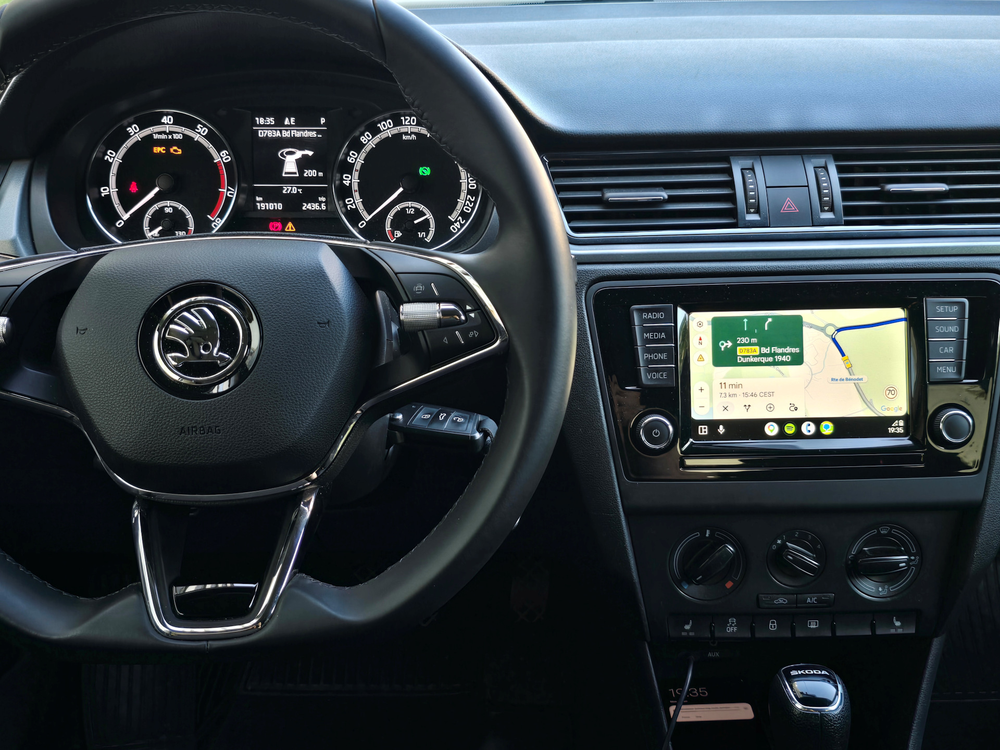
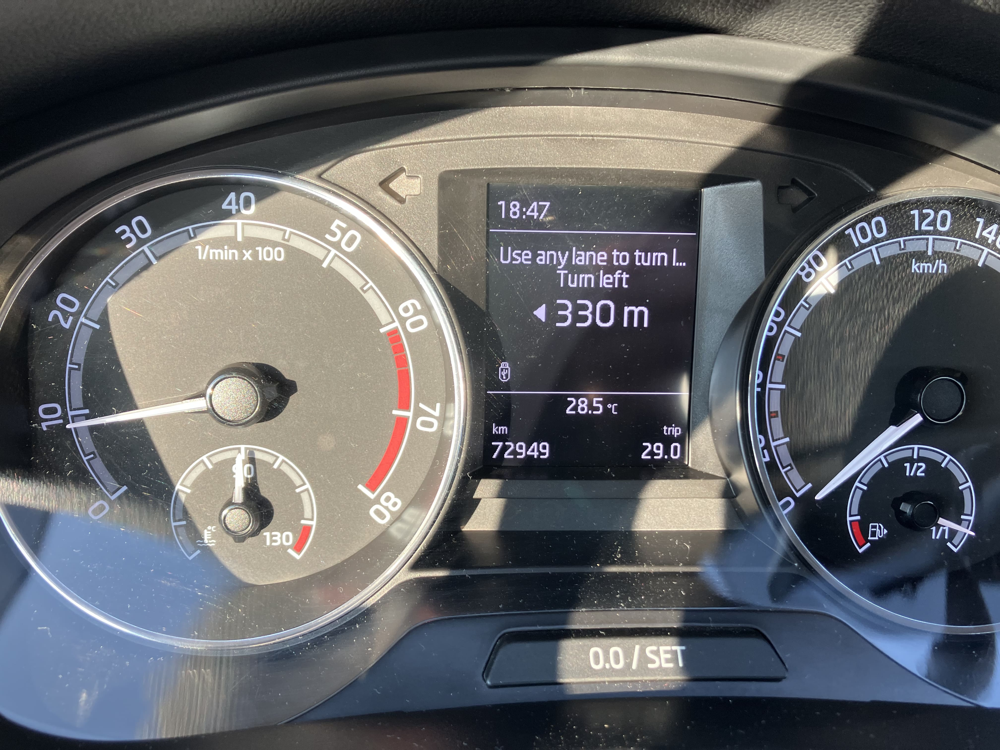
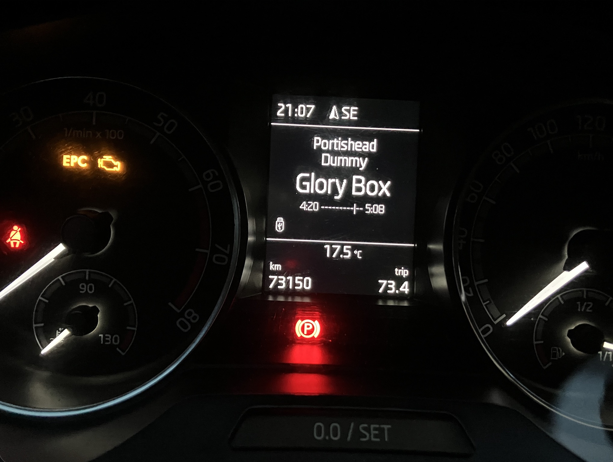
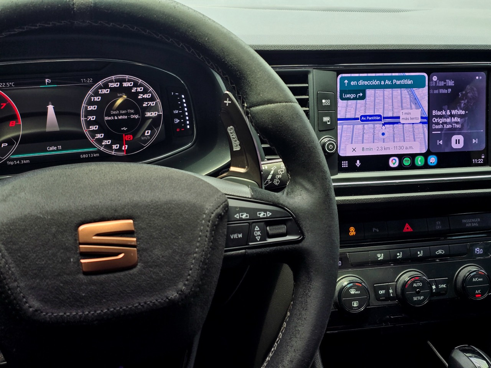
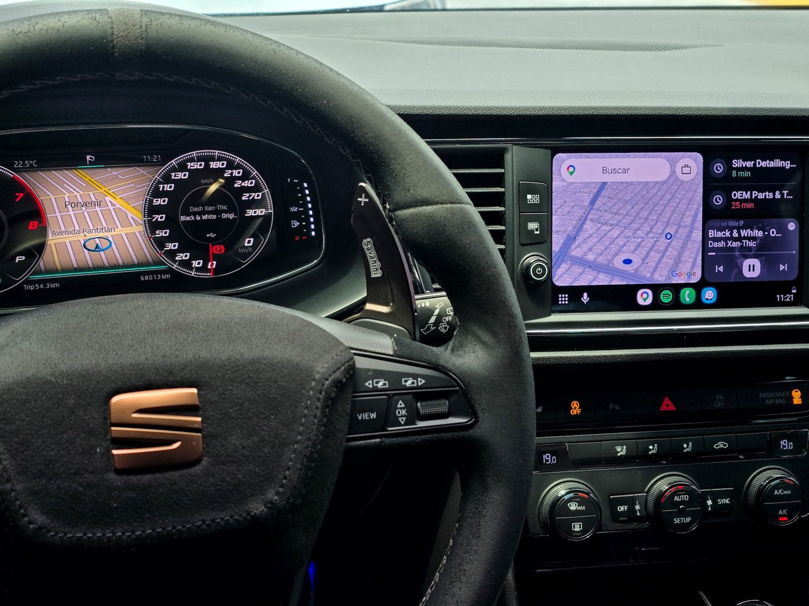
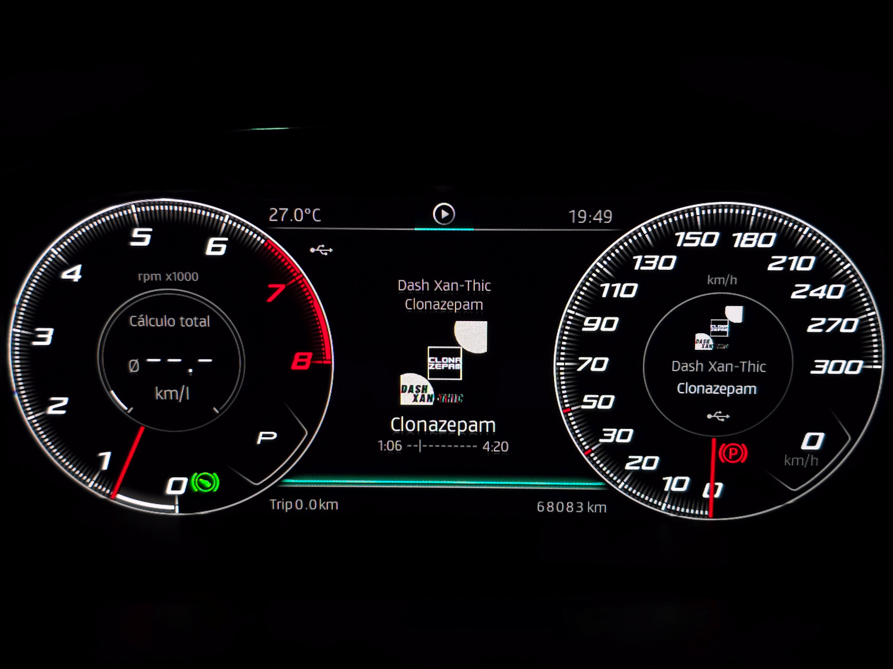
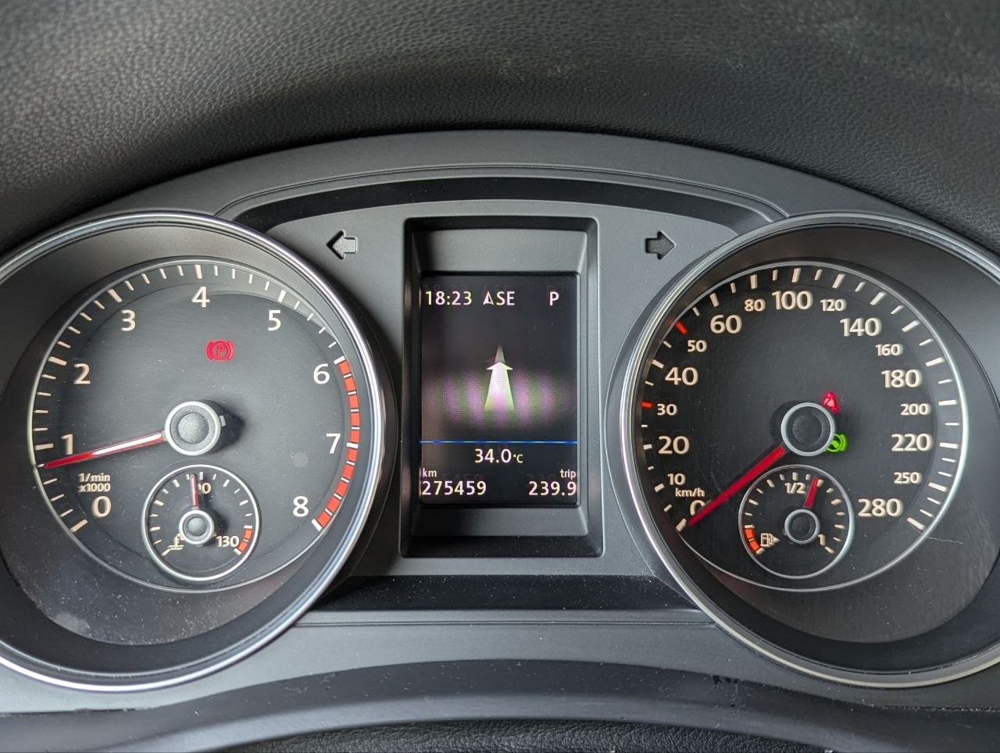
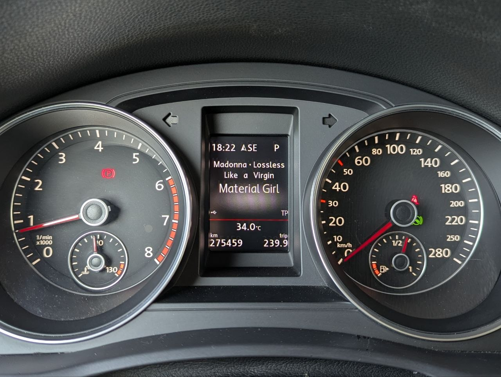

# Kombibridge — Android Auto navigation on the MIB2 STD2 instrument cluster

Show Android Auto turn-by-turn navigation (and player info) on the
instrument cluster of a **VW MIB2 STD2 / MST2** unit (TechniSat / Preh).

<p align="center">
  
  <br>
  <em>MIB2 <strong>with</strong> navigation (Amundsen): AA guidance driving the cluster's real Navigation menu.</em>
</p>

Stock MIB2 STD2 cannot do this: the firmware deliberately leaves the Android Auto
navigation bridge disabled, and the cluster is not coded for navigation. Kombibridge adds the
missing pieces — without reflashing the firmware and **fully reversible**.

Both instrument-cluster stacks are now supported — the **MQB** (`mqbab2`) and the **PQ** (`mqbpq`)
BAP cluster variants — so the same build works whether your cluster speaks the MQB or the older PQ
protocol.

> **Status:** working (navigation in the cluster's media widget, or the real Navigation menu on a
> nav-capable cluster, + real now-playing track).
> Personal/educational modding project. Use COMPLETELY at your own risk.

## Demo

<p align="center">
  
  <br>
  <em>On a unit <strong>without</strong> navigation (Bolero): AA turn-by-turn injected into the cluster's media now-playing widget.</em>
</p>

<p align="center">
  
  <br>
  <em><strong>Media mode:</strong> the real now-playing track (artist / album / title) with an ASCII progress
  bar (<code>Media.SHOW_PROGRESS</code>, off by default), shown when no route guidance is active.</em>
</p>

### SEAT Virtual Cluster (Digital Cockpit)

<p align="center">
  
  
  <br>
  <em>SEAT with the full <strong>Digital Cockpit</strong> (Virtual Cluster). <strong>Left:</strong> Android Auto
  turn-by-turn on the cluster during AA guidance. <strong>Right:</strong> with AA navigation off and the car's
  own (native) navigation active, Kombibridge shows the now-playing track on the cluster.</em>
</p>

<p align="center">
  
  <br>
  <em><strong>Cover art</strong> (<code>Media.SHOW_COVER_ART</code>, AID / colour Virtual Cockpit only): the Android Auto
  album cover pushed to the cluster alongside the now-playing track and the
  <code>Media.SHOW_PROGRESS</code> bar.</em>
</p>

### Older PQ cluster (mono centre display)

<p align="center">
  
  
  <br>
  <em>The older <strong>PQ</strong> cluster (small monochrome centre display between analogue gauges),
  with both output paths working independently.
  <strong>Left:</strong> Android Auto turn-by-turn maneuver via the navigation path.
  <strong>Right:</strong> the real now-playing track (artist / album / title) via the media path.</em>
</p>

---

## How it works

```
 Android Auto (phone)
      │  turn-by-turn + now-playing live inside Google's libext.google.gal.receiver.so,
      │  but the stock SAL never registers those endpoints
      ▼
 ┌─ shim/ ── patched libgal ────────────────────────────────┐
 │ registers Google's Navigation + MediaPlaybackStatus      │
 │ endpoints itself and asks the phone for AA protocol 1.7; │
 │ writes the maneuver, road, distance, lane guidance and   │
 │ destination distance + ETA to /dev/shmem/aa_nav, and the │
 │ now-playing track to /dev/shmem/aa_media                 │
 └──────────────────────────────────────────────────────────┘
      ▼
 ┌─ jar/ ── HMI Java mod (-Xbootclasspath/p) ───────────────┐
 │ reads the shmem files and renders them: on a nav-capable │
 │ cluster into the real navsd Navigation menu, on a        │
 │ non-nav one as text in the media now-playing widget      │
 │ (arrow, distance, street, lane row, destination ETA —    │
 │ both ways) — picked at runtime by ClusterCaps            │
 └──────────────────────────────────────────────────────────┘
      ▼
 Instrument cluster shows the live maneuver / track
```

Two firmware facts make this possible — the AA nav/media data is present in the GAL library but
never registered by the stock SAL, and the cluster's media widget is drawable while its nav slot
stays gated on a non-nav unit. Full write-up with the binary evidence:
**[`docs/ARCHITECTURE.md`](docs/ARCHITECTURE.md)**; the nav-capable path:
**[`docs/NAVIGATION_VIA_NAVSD.md`](docs/NAVIGATION_VIA_NAVSD.md)**.

---

## Repository layout

```
jar/      HMI Java mod  → builds AAtoKombi.jar
  src/        our sources (incl. faithful shadows of several stock classes: the audio + AA targets
              and the navsd nav functions)
  build.sh    one-command build (javac + jar)
  lib/        ← MIBHMI.jar (staged here by build.sh from the MIBHMI.jxe)

shim/     native libgal patch → builds the patched .so   (files + RE specs: shim/README.md)
  build.sh    compile + link + inject
  lib/        ← put unit's libext.google.gal.receiver.so here

docs/     ARCHITECTURE.md          — the design + notes
          NAVIGATION_VIA_NAVSD.md  — the nav-capable (navsd Navigation-menu) output path

build.sh          one-button build of BOTH artifacts from the toolbox dumps (all in Docker)
docker/           the build toolchain image (JDK 8 + clang + lld + pyelftools)
tools/            optional firmware-extraction / shadow-verification helpers
```

The on-device **deployment** (SD card, Green Engineering Menu, activate/deactivate scripts)
lives in a separate toolbox repository —
[olli991/mib-std2-pq-zr-toolbox](https://github.com/olli991/mib-std2-pq-zr-toolbox) — this repo
only builds the two artifacts.

---

## Patch the unit (step by step)

You build the two artifacts **against the exact files from your own unit**, then deploy them back
with the toolbox. The libgal patch reads what it needs out of your file: the function addresses
from its symbols and the object layouts (where the message router sits, the endpoint fields, the
vtable slots, the buffer words) from the code of its own small functions. When that code does not
look as expected the build stops and writes nothing, rather than produce a library that crashes;
when only the media part differs, it builds without now-playing. The mod has been run in a car on
**`MST2_EU_SK_ZR_P0480T`** only, and the shadowed HMI classes come from that build — on another
firmware a successful build is a good sign, not a test drive.

> For a pure **FTP + Telnet** install/build/rollback flow, follow
> [`docs/INSTALL_FTP_TELNET.md`](docs/INSTALL_FTP_TELNET.md) instead (Still requires toolbox to enable FTP/Telnet).

### 0. Prerequisites (once)
- **The deployment toolbox** ([olli991/mib-std2-pq-zr-toolbox](https://github.com/olli991/mib-std2-pq-zr-toolbox)) set up for your unit.
- **Docker** — the whole build runs in containers (the vendored `tools/jxe2jar` converter + the JDK 8 / clang / lld / pyelftools
  toolchain), so nothing else needs installing.

### 1. Pull the two files off the unit (with the toolbox)
Use the toolbox's **"Dump files"** menu item to copy these from the unit to your computer:
- **`MIBHMI.jxe`** — the HMI executable (from `/tsd/hmi/ifs/`). `build.sh` turns it into the HMI
  compile classpath (`MIBHMI.jar`) for you, inside Docker.
- **`libext.google.gal.receiver.so`** — the stock GAL library (from `/tsd/lib/sal/gal/`). This is
  the file we patch, so it **must be the copy from the unit** (different firmware builds differ —
  that's exactly what the shim's auto-resolve handles).

> Keep an untouched backup of the original `libext.google.gal.receiver.so` — the toolbox's
> Disable step restores it, but a manual backup is cheap insurance.

### 2. Build both artifacts
```sh
./build.sh /path/to/your/MIBHMI.jxe /path/to/your/libext.google.gal.receiver.so
# -> dist/AAtoKombi.jar                  (the HMI mod)
# -> dist/libext.google.gal.receiver.so  (the patched libgal)
```

To build the capture-only MST2 VideoSink probe, pass the environment variable through the Docker
build:

```sh
VIDEO_PROBE=1 ./build.sh /path/to/your/MIBHMI.jxe /path/to/your/libext.google.gal.receiver.so dist-probe
```

The resulting `dist-probe/libext.google.gal.receiver.so` records callback counters in
`/dev/shmem/aa_video_probe`; it does not render video to the cluster. In PowerShell, use
`$env:VIDEO_PROBE = "1"` before invoking the script with Bash.

The heavy one-shot forensic collector is opt-in with `VIDEO_PROBE_DEEP=1`; it is intended for a
single controlled diagnostic run and is not the normal probe mode.

Android Auto map on the Active Info Display (experimental) is opt-in with `CLUSTER_SINK=1`. The
patched libgal advertises a second, cluster-type H.264 display to the phone and passes its stream
to DisplayManager through shared memory; `native/libkb_dm.so`, preloaded into DisplayManager, sends
it to the cluster in place of the stock map video. See `native/README.md` (install, off switches,
risks) and `shim/DESIGN_VIDEO_PIPELINE.md`. If Android Auto stops connecting, put the normal libgal
back; if the unit resets at boot, remove the hook with `native/install/uninstall_dm_hook.sh`.

```sh
CLUSTER_SINK=1 ./build.sh /path/to/your/MIBHMI.jxe /path/to/your/libext.google.gal.receiver.so dist-cluster
# -> dist-cluster/{AAtoKombi.jar, libext.google.gal.receiver.so, libkb_dm.so, install_dm_hook.sh, uninstall_dm_hook.sh}
```

If Docker reports `Operation not permitted` while writing `shim/build/navshim.o`, remove only the
generated shim artifacts and rerun the same command:

```powershell
Remove-Item shim/build/navshim.o,shim/build/navshim.so,shim/build/libext.google.gal.receiver.so -Force -ErrorAction SilentlyContinue
```

Everything runs in Docker: it converts the `.jxe` to a jar, builds the toolchain image (cached
after the first run), compiles both artifacts inside the container with the repo bind-mounted, and
drops the two deployables in `dist/`.

On Windows, start Docker Desktop with Linux containers and double-click `build.bat`. It asks for
`MIBHMI.jxe` and the stock `libext.google.gal.receiver.so` in two Open dialogs, builds, and opens
the `dist` folder with the results. From PowerShell it takes the same arguments as `build.sh`:
```powershell
.\build.bat C:\path\to\MIBHMI.jxe C:\path\to\libext.google.gal.receiver.so
```
No Git Bash, WSL distribution or host Python is needed, and the window stays open afterwards so
errors remain visible. The build adapts to your firmware automatically (the libgal patch
resolves its per-build addresses from the file you pass, and the jar is rebuilt against your unit's
`MIBHMI.jar`).

### 3. Deploy both artifacts back to the unit (with the toolbox)
Put the two `dist/` outputs onto the toolbox SD card, then run the toolbox's Enable step:
- copy `dist/AAtoKombi.jar` to the SD `custom/java/` folder,
- copy `dist/libext.google.gal.receiver.so` to the SD `custom/sal/...gal/` folder.

The Enable step then installs the jar onto the HMI `-Xbootclasspath/p` (in `runHMI.sh`) and swaps in
the patched libgal (keeping a backup of the original).

It's **fully reversible** — the toolbox's Disable removes the jar from the bootclasspath and
restores the original libgal. Nothing is written to flash by the mod itself (the captured data
goes through `/dev/shmem`, a RAM filesystem).

### 4. Verify on the unit
- Connect your phone over Android Auto and start navigation → the cluster's media tab shows the
  maneuver + street; play music with no active route → it shows the real Title/Artist/Album.
- On MQB non-nav clusters, turn the wheel in the Audio menu during guidance to select music
  (NEXT) or navigation (PREVIOUS). Repeated turns in the same direction keep the chosen view;
  a new route starts with navigation. This works when `SHOW_NAV` and `SHOW_MEDIA` are enabled.
  Nav-capable clusters and separate steering-wheel track buttons retain their normal behavior.
  Wheel view selection is not implemented for the PQ input path.
- If something's off, check that `/dev/shmem/aa_nav` and `/dev/shmem/aa_media` exist and advance
  while the phone is connected (the patched libgal writes them) and the `MIBLogger` output for
  `AANavReader` / `ShmemMediaReader` lines.

### Options
The defaults just work. All build-time switches live in one file —
`jar/src/de/aatokombi/Config.java`, grouped by topic; flip a constant and rebuild the jar
(`build.sh` prints the values that went into the build, as `Group.NAME value`):
- `Navigation.ENABLED` — draw AA turn-by-turn on the cluster (the navsd **Navigation** menu on a
  nav-capable cluster, the media widget on a non-nav one); also the master switch of the AA map on
  the AID. Default on. Next to it: `SHOW_NEXT_MANEUVER`, `SHOW_DOUBLE_TURN`,
  `SHOW_JUNCTION_SCHEMATIC` (all default on).
- `ManeuverStages.*` — how the arrow develops as the turn approaches: the *follow the street* and
  *prepare* stages (`FOLLOW_STREET`, `PREPARE`) and their distance / time gates (`NEAR_*`,
  `PREPARE_*`).
- `Media.ENABLED` — show the real now-playing track when not navigating or when selected
  with the wheel.
  Default on. `Media.SHOW_PROGRESS` adds an ASCII playback progress bar (default off);
  `Media.SHOW_COVER_ART` pushes the AA album cover to the cluster (AID / colour Virtual Cockpit
  only; inert on a monochrome cluster; default on). Both need `Media.ENABLED`.
- `ClusterMap.*` — Android Auto's own map on the AID (needs the CLUSTER_SINK libgal and
  `libkb_dm.so`): `START_ON_MAP`, `AA_MAP_ONLY_DURING_GUIDANCE`, `MODE_CYCLE`.
- `Advanced.SUPPRESS_NAV_ACTIVE_PLACEHOLDER` — hide the stock *"Navigation on the mobile device is
  active"* cluster placeholder. Default on. `Advanced.LOG_LEVEL` — log verbosity (`TRACE` …
  `SILENT`).

Deeper build notes: [`docs/`](docs/) and [`shim/README.md`](shim/README.md).

---

## Credits
Kombibridge is a port of **[adi961/mib2-android-auto-vc](https://github.com/adi961/mib2-android-auto-vc)**
(Android Auto navigation on the cluster for MIB2 **High** / MHI2) to MIB2 **STD2** / MST2. The HMI
side — the AA target handling, the navigation handler, and the `de.adi961.miblogger` logger — comes
from that project. adi961's mod in turn builds on the LSD/bootclasspath work of
[grajen3](https://github.com/grajen3/mib2-lsd-patching) and
[andrewleech](https://github.com/andrewleech). The STD2 shim and the media-widget approach are new
here.
